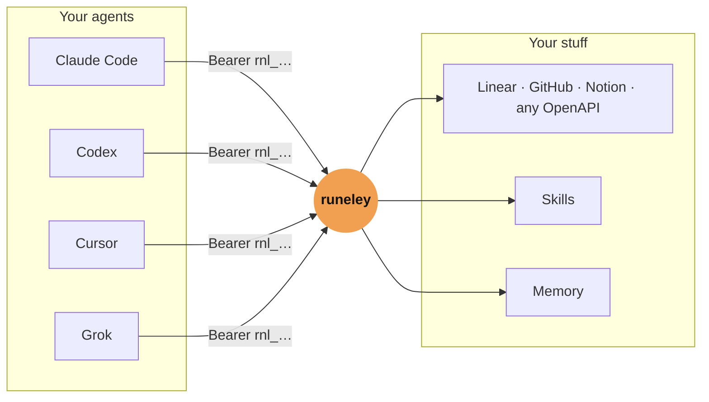

<picture>
  <source media="(prefers-color-scheme: dark)" srcset=".github/assets/banner-dark.svg" />
  
</picture>

<p align="center">
  
  
  
  
  
</p>

<p align="center">
  Connect Linear, GitHub and Notion <b>once</b>. Bring the skills and memories you already have.<br />
  Claude Code, Codex, Cursor, Antigravity and Grok all see the same tools and the same context, from <b>your</b> server.
</p>

<p align="center">
  <a href="#-quick-start"><b>Quick start</b></a> ·
  <a href="#-connect-your-agents"><b>Connect agents</b></a> ·
  <a href="#-reference"><b>Reference</b></a> ·
  <a href="https://x.com/andersonbrdev"><b>Follow the build</b></a>
</p>

<br />

## ✨ Why

Every agent lives on its own island. You log into Linear four times, copy the same skill to four folders, and teach Claude a rule that Codex never hears about.

runeley is the bridge: **one MCP endpoint, on your server**, in front of every account, skill and memory. It runs no model. Your agent thinks; runeley is where it finds tools and context.



## 🧩 What you get

| | |
|---|---|
| 🔌 **Connect once** | ~25 curated MCP servers with one-click OAuth, plus any remote MCP, local MCP or OpenAPI spec. |
| 🧠 **Shared memory** | Notes linked with `[[slug]]`, versioned, with health checks. What one agent learns, all of them know. |
| 📚 **Skills that travel** | Your `SKILL.md` folders, searchable and served on demand. |
| 📥 **Import in one go** | Memories, skills and instructions from Claude Code, Codex, Cursor, Grok, Gemini and OpenCode. |
| 🔑 **One key per agent** | Revoke one without touching the others. Every call audited. |
| 🏠 **Yours** | One container, SQLite, no third-party services. MIT. |

## 🚀 Quick start

```sh
curl -fsSL https://github.com/Andsu-dev/runeley/releases/latest/download/install.sh | sh
```

That is it. The script creates `~/runeley`, writes a `.env` with a fresh `RUNELEY_SECRET`, pulls the image and starts it on `127.0.0.1:4312`. Open the link it prints, create your account and follow **Acesso → Configurar agentes**.

<details>
<summary><b>Installer options</b></summary>

Options go in front of `sh`:

```sh
curl -fsSL https://github.com/Andsu-dev/runeley/releases/latest/download/install.sh \
  | PUBLIC_URL=https://runeley.example.com RUNELEY_DIR=/opt/runeley RUNELEY_VERSION=v0.1.0 sh
```

**Update**: `cd ~/runeley && docker compose pull && docker compose up -d`

</details>

<details>
<summary><b>Docker Compose by hand</b></summary>

```yaml
services:
  runeley:
    image: ghcr.io/andsu-dev/runeley:latest
    restart: unless-stopped
    env_file: .env
    ports:
      - "127.0.0.1:4312:4312"
    volumes:
      - ./data:/data
```

```sh
PUBLIC_URL=https://runeley.example.com     # the URL people and agents use
RUNELEY_SECRET=$(openssl rand -hex 32)      # encrypts connections and API keys; back it up
ALLOW_SIGNUP=false                          # first signup becomes the owner, then signups close
```

</details>

<details>
<summary><b>Build from source</b></summary>

```sh
git clone https://github.com/Andsu-dev/runeley.git && cd runeley
cp .env.example .env    # set PUBLIC_URL and RUNELEY_SECRET
docker compose up -d --build
```

> `bun run dev` is only for working on runeley itself. To run it, use the image.

</details>

<details>
<summary><b>HTTPS (Caddy or Cloudflare Tunnel)</b></summary>

**Caddy**

```caddy
runeley.example.com {
  reverse_proxy 127.0.0.1:4312
}
```

**Cloudflare Tunnel**

```yaml
ingress:
  - hostname: runeley.example.com
    service: http://127.0.0.1:4312
  - service: http_status:404
```

OAuth callbacks go to `PUBLIC_URL/v1/oauth/callback`, so `PUBLIC_URL` must be the public address.

</details>

<details>
<summary><b>Environment variables</b></summary>

| Variable | Default | Description |
|---|---|---|
| `PUBLIC_URL` | `http://localhost:4312` | Public URL of the panel and API. Used for OAuth callbacks and cookies. |
| `RUNELEY_SECRET` | required, 32+ chars | Encrypts connection configs, OAuth tokens and recoverable API keys. Losing it means reconnecting everything. |
| `RUNELEY_SETUP_TOKEN` | generated | One-time token required to create the first account. |
| `ALLOW_SIGNUP` | `false` | Keep signups open after the first account. |
| `RUNELEY_ENABLE_EXECUTE` | `true` | Enables the sandboxed `execute` tool. See Security. |
| `RUNELEY_ENABLE_STDIO` | `false` | Enables local MCP servers by command. See Security. |
| `RUNELEY_ALLOW_PRIVATE_URLS` | `false` | Allows connections to private network addresses. |
| `RUNELEY_RATE_LIMIT_PER_MINUTE` | `240` | Requests per minute allowed for each API key. |
| `GITHUB_CLIENT_ID` / `GITHUB_CLIENT_SECRET` | empty | Enables "Sign in with GitHub" on the panel. |
| `RUNELEY_DATA` | `/data` in Docker | Where the SQLite database lives. |
| `PORT` / `HOST` | `4312` / `0.0.0.0` in Docker | Where the server listens. |

</details>

## 🤖 Connect your agents

1. In the panel, open **Acesso → Configurar agentes**. The guide walks you through connecting accounts, creating a key and wiring each client.
2. Or paste the config yourself (replace the URL and key):

**Claude Code**

```sh
claude mcp add --scope user --transport http runeley https://runeley.example.com/v1/mcp \
  --header "Authorization: Bearer rnl_..."
```

**Codex** (`~/.codex/config.toml`)

```toml
[mcp_servers.runeley]
url = "https://runeley.example.com/v1/mcp"
http_headers = { Authorization = "Bearer rnl_..." }
```

**Grok** (`~/.grok/config.toml`)

```toml
[mcp_servers.runeley]
url = "https://runeley.example.com/v1/mcp"
headers = { Authorization = "Bearer rnl_..." }
```

**Cursor** (`~/.cursor/mcp.json`)

```json
{ "mcpServers": { "runeley": { "url": "https://runeley.example.com/v1/mcp", "headers": { "Authorization": "Bearer rnl_..." } } } }
```

**All of them at once** (run on your computer, inside a clone of this repo, with [Bun](https://bun.sh)):

```sh
bun install
RUNELEY_URL=https://runeley.example.com RUNELEY_API_KEY=rnl_... bun run install-clients
```

## 📥 Bring your context

The CLI runs on your computer, because that is where your agents keep their files.

```sh
export RUNELEY_URL=https://runeley.example.com
export RUNELEY_API_KEY=rnl_...

bun run import            # MCP servers from Claude, Codex, Grok and Cursor configs become connections
bun run import-context    # memories, skills and global instructions from every installed agent
bun run sync-context      # writes a short brief into CLAUDE.md and AGENTS.md
```

`import-context` reads:

| Agent | Skills | Memory and instructions |
|---|---|---|
| Claude Code | `~/.claude/skills` | `~/.claude/projects/*/memory`, `~/.claude/CLAUDE.md` |
| Agents (universal) | `~/.agents/skills` | |
| Codex | `~/.codex/skills` | `~/.codex/memories`, `~/.codex/AGENTS.md` |
| Cursor | `~/.cursor/skills`, `~/.cursor/skills-cursor` | |
| Grok | `~/.grok/skills` | `~/.grok/AGENTS.md` |
| Gemini | `~/.gemini/skills` | `~/.gemini/GEMINI.md` |
| OpenCode | `~/.config/opencode/skills` | `~/.config/opencode/AGENTS.md` |

Duplicates are merged (first one wins). Memories listed under `## Regras de ouro` in a `MEMORY.md`, and global instruction files, come in pinned.

`sync-context` only touches the block between `<!-- runeley:start -->` and `<!-- runeley:end -->`. Everything else in your files stays as it is. The brief tells agents to save new facts with `write_memory`, so memory flows back to runeley instead of local files.

## 📖 Reference

<details>
<summary><b>MCP tools</b></summary>

| Tool | What it does |
|---|---|
| `list_connections` | Every connection with status and tool count. |
| `search_tools` | Search tools across all connections (`source.tool`). |
| `call_tool` | Call one tool with arguments. |
| `execute` | Run JavaScript that chains tools inside a WebAssembly sandbox: `await tools.linear.list_issues({...})`. |
| `search_context` | Full-text search across memories and skills. |
| `read_memory` / `write_memory` | Read a memory, or create and update one (versioned). |
| `read_skill` / `read_skill_file` | Read a skill and its files. |

</details>

<details>
<summary><b>REST API</b></summary>

Everything the panel does goes through a versioned JSON API. Every response is `{ data, error }`.

| Method | Route | Auth |
|---|---|---|
| `*` | `/v1/auth/*` | better-auth (email and password, GitHub) |
| GET | `/v1/me` | session |
| GET, POST | `/v1/organizations`, `POST /v1/organizations/active` | session |
| GET, POST | `/v1/api-keys`, `DELETE /v1/api-keys/:id`, `GET /v1/api-keys/:id/secret` | session |
| GET, POST | `/v1/sources`, `/v1/sources/summary`, `/v1/sources/import` | session or API key |
| GET, PATCH, DELETE | `/v1/sources/:name`, `POST /v1/sources/:name/test`, `POST /v1/sources/:name/oauth` | session or API key |
| GET, POST | `/v1/catalog`, `/v1/catalog/install` | session or API key |
| GET, POST, PATCH, DELETE | `/v1/memories`, `/v1/memories/:slug`, `/v1/memories/:slug/versions`, `/v1/memories/health`, `/v1/memories/import` | session or API key |
| GET, POST, PATCH, DELETE | `/v1/skills`, `/v1/skills/:slug`, `/v1/skills/:slug/files`, `/v1/skills/import` | session or API key |
| GET | `/v1/context/search`, `/v1/context/brief` | session or API key |
| GET | `/v1/activity/summary`, `/v1/onboarding`, `/v1/tools` | session or API key |
| `*` | `/v1/mcp` | API key |

</details>

<details>
<summary><b>🔒 Security</b></summary>

runeley holds credentials for every account you connect, so it is locked down by default.

**First access.** While no account exists, signing up needs a one-time setup token. The installer generates it and prints the link (`/login?mode=signup&token=…`). Without `RUNELEY_SETUP_TOKEN` in `.env`, the server makes one at startup and prints the link in `docker compose logs`. After the first account, signups close (unless `ALLOW_SIGNUP=true`).

**Credentials.**
- Connection configs, OAuth tokens and recoverable API keys are encrypted with AES-256-GCM using `RUNELEY_SECRET`.
- Agents never receive credentials: requests made with an API key, and the `list_connections` tool, see headers and env values as `••••••`.
- Importing a client config through the API never expands `${VARS}` from the server environment.
- API keys belong to one organization. Revealing a key needs a panel session, never an API key.

**Risky capabilities.**

| Variable | Default | What it unlocks |
|---|---|---|
| `RUNELEY_ENABLE_EXECUTE` | `true` | The `execute` tool. Agent code runs in QuickJS compiled to WebAssembly: a fresh sandbox per run with no filesystem, network, process or timers, 32 MB of memory and CPU and wall-clock limits. Tools cross the boundary as JSON only. Turn it off if you only want single `call_tool` calls. |
| `RUNELEY_ENABLE_STDIO` | `false` | Local MCP servers (`command`). Even when on, only an owner or admin in the panel can create them, and the process gets a minimal environment (no server secrets). |
| `RUNELEY_ALLOW_PRIVATE_URLS` | `false` | Connections to private, loopback, link-local and tailnet addresses (SSRF protection: cloud metadata, other services on the host). |

**Prompt injection.** Tool results come from third parties (an issue, a page, an email). runeley limits what a manipulated agent can do: it cannot read credentials, cannot pin memories (pinned memories go into every agent's instructions, so only the panel can pin) and `execute` code runs in a WebAssembly sandbox with no access to the server. It can still write unpinned memories and call the tools you connected, so review memory health from time to time.

**Abuse and visibility.**
- Every API key has a sliding-window rate limit (`RUNELEY_RATE_LIMIT_PER_MINUTE`, default 240). Over the limit the API answers `429` with `retry-after`.
- Every request made with an API key is audited: tool calls (source, tool, result, duration) and REST calls (method, path, status, IP). Open **Chaves de API → Atividade** to see one key's timeline.

**Network.** Every outgoing request (MCP, OAuth, OpenAPI) resolves DNS and checks the address right before it goes out, and redirects are followed one hop at a time with the same check, so DNS rebinding and redirects cannot reach private addresses.

**Container.** The image starts as root only to fix the ownership of `/data`, then drops to the unprivileged `node` user. The application code stays read-only for that user. Keep the `127.0.0.1` binding (the default) and put HTTPS in front.

</details>

<details>
<summary><b>Operations: backup, update, health</b></summary>

**Backup**: copy the `data/` folder (the SQLite database) and keep `RUNELEY_SECRET` somewhere safe. Both are needed to restore.

**Update**: `docker compose pull && docker compose up -d` (or `git pull && docker compose up -d --build` from source). Migrations run on startup.

**Health**: `GET /health` returns `ok`. The container has a healthcheck.

</details>

<details>
<summary><b>Development</b></summary>

```sh
bun install
cp .env.example .env          # PUBLIC_URL=http://localhost:5173 for dev
bun run seed                  # demo user, organization, connections and an API key
bun run dev                   # API on :4312, panel on :5173 (Vite proxies /v1)
```

```
apps/
  api/      Hono + better-auth + SQLite. Feature modules in src/modules/<feature>/{routes,services,repositories,...}
  web/      React + Vite + TanStack Router/Query + Tailwind + motion
  cli/      import, import-context, sync-context, install-clients
packages/
  shared/   zod schemas, types and the { data, error } Result used by every app
```

| Script | |
|---|---|
| `bun run dev` | API and panel with hot reload |
| `bun run build` | Builds the panel (served by the API in production) |
| `bun run typecheck` | `tsc` in every package |
| `bun run check` | Biome format and lint |
| `bun run seed` | Demo data for local development |

</details>

## 🗺️ Roadmap

- Tools page with per-tool approval policies
- Organization members and invites
- Activity log per API key
- Menu bar app for macOS (reconnect alerts)

<br />

<p align="center">
  MIT · made by <a href="https://x.com/andersonbrdev"><b>@andersonbrdev</b></a>. Follow the build on X.
</p>
